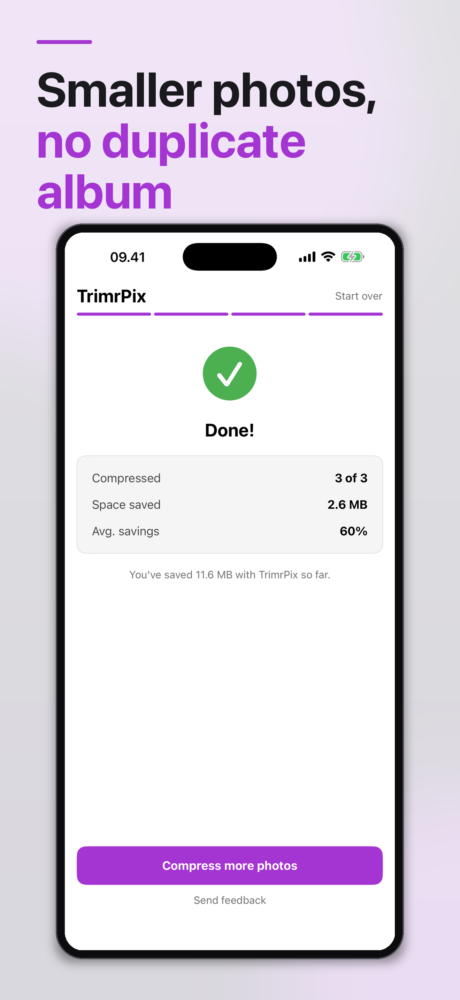
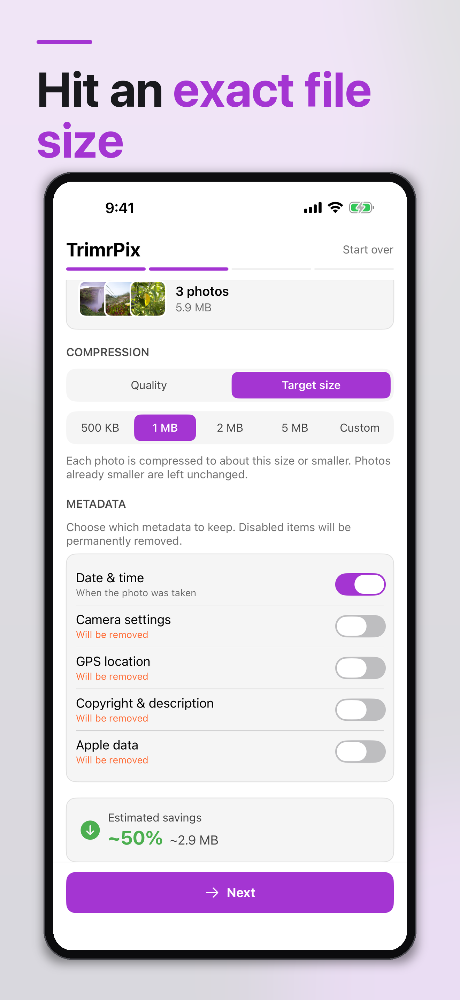

<picture>
  <source media="(prefers-color-scheme: dark)" srcset="TrimrPix%20for%20iOS/Assets.xcassets/AppIcon.appiconset/app-icon-dark.png">
  
</picture>

# TrimrPix for iOS

Smaller photos. No duplicates.

<!-- IAMJARL README store block for TrimrPix for iOS (en). Generated from apps.json, v1.34.0. Do not edit. -->

  <a href="https://apps.apple.com/app/id6761081919?pt=128512007&amp;ct=github&amp;mt=8"><picture>
    <source media="(prefers-color-scheme: dark)" srcset="https://raw.githubusercontent.com/JarlLyng/iamjarl-design/v1.34.0/badges/app-store-white-en-us.svg">
    
  </picture></a>
   
  $1.99 once · iOS 17 or later · <a href="https://trimrpixforios.iamjarl.com">trimrpixforios.iamjarl.com</a>

  
  

TrimrPix compresses the photos you pick and puts each one back in your Photos library in place of the original, so there is no duplicate album to clean up afterwards. Choose a quality level, or a target size per photo such as 1 MB, and see the estimated savings before anything changes. Each photo keeps its format, photos stored in iCloud are downloaded and saved back, and you decide which metadata stays, from the date taken to the GPS location. Compression runs on your iPhone. TrimrPix has no server and no account, and all it sends is anonymous crash reports, never your photos.

## For developers

  <a href="https://madebyhuman.iamjarl.com"><picture>
    <source media="(prefers-color-scheme: dark)" srcset="https://madebyhuman.iamjarl.com/badges/co-created-white.svg">
    </picture></a>
  

The developer half: what's in the app, how to build and run it, how to contribute, and the license. The macOS sister app is a separate project at [trimrpix.iamjarl.com](https://trimrpix.iamjarl.com).

### What's in it

- **Select and compress:** pick photos, choose quality or a target size, slide to confirm.
- **In-place replacement:** the original is replaced in the Photos library, with no duplicate left behind.
- **Two modes:** a quality level (Same, Good or Smaller), or a target size per photo (500 KB, 1 MB, 2 MB, 5 MB or a custom size).
- **Original format kept:** JPEG, PNG and HEIC are compressed in their own format. There is no format picker, because Photos rejects an in-place edit that changes the format.
- **Metadata control:** keep or strip date and time, camera settings, GPS location, copyright and description (IPTC), and Apple data.
- **Savings estimate:** the expected saving, as a percentage and a size, before you confirm.
- **iCloud photos:** downloaded, compressed and saved back.
- **Localized:** English, Danish, German, French and Japanese.
- **Private:** no account, no server and no ads. Sentry crash reports are anonymous and carry no photos.

Requirements: iOS 17.0 or later on iPhone or iPad (a universal app), with full or limited access to the Photos library.

### Build and run

1. Clone the repo.
2. Copy `TrimrPix for iOS/Secrets.swift.template` to `Secrets.swift`. Sentry is optional: leave the DSN as the placeholder and the app runs without crash reporting.
3. (Optional, for uploading dSYMs to Sentry) Create `Sentry.xcconfig` in the project root with `SENTRY_AUTH_TOKEN = <your-token>`.
4. Open `TrimrPix for iOS.xcodeproj` in Xcode.
5. File → Packages → Resolve Package Versions.
6. Build and run. The unit tests are the `TrimrPix for iOSTests` target: **Product → Test** or `⌘U`.

`Secrets.swift` and `Sentry.xcconfig` are gitignored and never committed.

**Tech stack:** Swift · SwiftUI · PhotosUI · Photos · ImageIO · StoreKit · [Sentry](https://sentry.io) · [IAMJARLDesignTokens](https://github.com/JarlLyng/iamjarl-design)

**Documentation:**

- [`AGENTS.md`](AGENTS.md): project context for developers and AI assistants.
- [`docs/spec.md`](docs/spec.md): the product specification.
- [`docs/architecture.md`](docs/architecture.md): the technical architecture.

### Contributing

Read [CONTRIBUTING.md](CONTRIBUTING.md) first. Bugs, feature requests and planned work are [GitHub Issues](https://github.com/JarlLyng/TrimrPix-for-iOS/issues) on this repo. This is a small, focused app, so if you're proposing a feature, open an issue to discuss the fit before writing code. Security issues go through [SECURITY.md](SECURITY.md).

For support, write to **support@iamjarl.com**. The app's result screen has a **Send feedback** link that opens the same address with your app and iOS version filled in, and there is a [support page](https://trimrpixforios.iamjarl.com/support.html). GitHub issues are a second route, not the only one.

### License

Open source under the [GNU AGPL-3.0](LICENSE). You're welcome to read, learn from and build on the code; under the AGPL, any distributed derivative must also be released under the AGPL. If you'd rather just use the app, the polished build is on the [App Store](https://apps.apple.com/app/id6761081919).

TrimrPix for iOS is made by Jarl at [IAMJARL](https://iamjarl.com). Copyright © 2026 IAMJARL.
